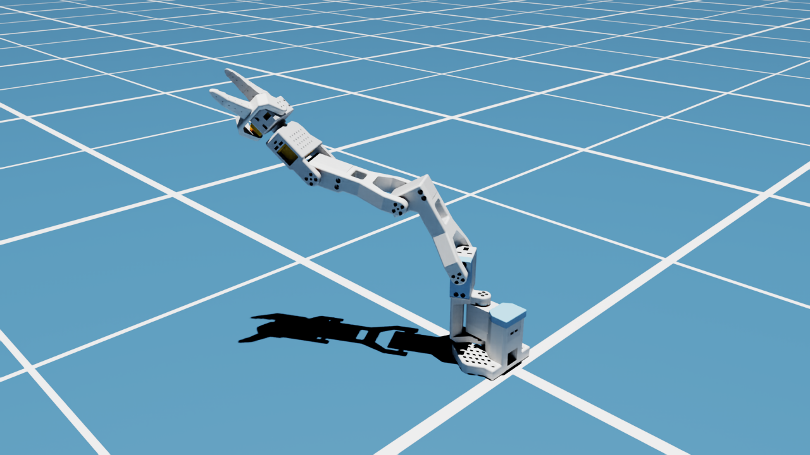
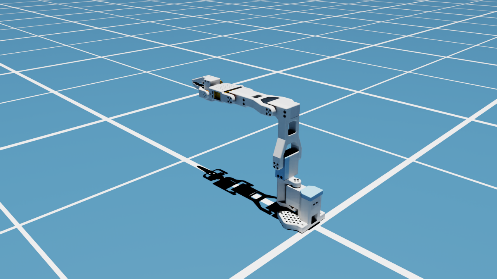

# SO_101_SML

Mô hình cánh tay robot **SO-101** (bản dựng lại trên Onshape của lab SML) cho mô phỏng: URDF có đầy đủ thông số vật lý và USD cho **Isaac Sim 6.1** với collision mesh đầy đủ.



Quy trình: **Onshape assembly → [onshape-to-robot](https://github.com/Rhoban/onshape-to-robot) → URDF → bổ sung vật lý SO-101 gốc → Isaac Sim URDF importer → USD**

## Nội dung repo

```
SO_101_SML/
├── export.sh                 # Onshape -> description/SO_101_SML.urdf (+ bổ sung vật lý)
├── .env.example              # mẫu Onshape API key (copy thành .env, không commit)
├── requirements.txt
├── description/
│   ├── config.json           # cấu hình onshape-to-robot (URL assembly, joint, post-process)
│   ├── SO_101_SML.urdf       # URDF đã xuất + đã bổ sung vật lý
│   └── assets/               # 70 mesh STL (visual + collision)
├── scripts/
│   └── so101_physics.py      # bổ sung khối lượng/quán tính/dynamics theo SO-101 gốc
├── isaac/
│   ├── import_so101.py       # URDF -> USD (Isaac Sim 6.1), convex decomposition, thông số PhysX
│   ├── test_so101.py         # kiểm thử: đứng vững, bám target, collision, chụp ảnh
│   ├── pick_place_cube.py    # pick & place cube 2 cm (headless) + quay video 4 góc
│   ├── so101_kinematics.py   # FK/IK số (numpy) đọc trực tiếp từ URDF
│   └── usd/SO_101_SML/       # USD đã import sẵn, mở thẳng trong Isaac Sim
└── docs/images/              # ảnh chụp từ test_so101.py
```

## Thông số robot

### Khớp

| Khớp | Loại | Giới hạn | Effort | Vận tốc |
|---|---|---|---|---|
| `shoulder_pan` | revolute | −90° … 90° | 2.94 N·m | 10 rad/s |
| `shoulder_lift` | revolute | −90° … 90° | 2.94 N·m | 10 rad/s |
| `elbow_flex` | revolute | −90° … 90° | 2.94 N·m | 10 rad/s |
| `wrist_flex` | revolute | −90° … 90° | 2.94 N·m | 10 rad/s |
| `wrist_roll` | revolute | **−360° … 0°** | 2.94 N·m | 10 rad/s |
| `gripper` | revolute | 0° … 90° | 2.94 N·m | 10 rad/s |

Ngoài ra có 2 frame cố định: `gripper_frame_link` và `jaw_tip`.

Giới hạn khớp lấy nguyên từ mate limit trong Onshape. Vị trí 0 của mỗi khớp là tư thế của assembly tại lúc xuất.

### Link và khối lượng

| Link (URDF) | Tương ứng SO-101 gốc | Khối lượng |
|---|---|---|
| `base_arm` | `base_link` | 0.147 kg |
| `part_31` | `shoulder_link` | 0.100 kg |
| `part_37` | `upper_arm_link` | 0.103 kg |
| `part_42` | `lower_arm_link` | 0.104 kg |
| `part_63` | `wrist_link` | 0.079 kg |
| `part_56` | `gripper_link` | 0.087 kg |
| `moving_jaw_so101_v1` | `moving_jaw_so101_v1_link` | 0.012 kg |
| **Tổng** | | **0.632 kg** |

### Nguồn thông số vật lý

Lấy từ [TheRobotStudio/SO-ARM100 › Simulation/SO101](https://github.com/TheRobotStudio/SO-ARM100/tree/main/Simulation/SO101):

| Thông số | Giá trị | Nguồn |
|---|---|---|
| Khối lượng link | bảng trên | `so101_new_calib.urdf` |
| Trọng tâm, tensor quán tính | tính từ mesh collision của model này (mật độ đồng nhất), scale theo khối lượng gốc | `scripts/so101_physics.py` |
| Damping thụ động | 0.60 N·m·s/rad | class `sts3215`, `so101_new_calib.xml` |
| Ma sát (frictionloss) | 0.052 N·m | class `sts3215` |
| Armature | 0.028 kg·m² | class `sts3215` (chỉ có trong USD) |
| Bộ điều khiển vị trí kp / kv | 998.22 N·m/rad / 2.731 N·m·s/rad | class `sts3215` (chỉ có trong USD) |
| Effort tối đa | 2.94 N·m | `forcerange` của class `sts3215` |
| Vận tốc tối đa | 10 rad/s | `so101_new_calib.urdf` |

> Không copy thẳng trọng tâm và quán tính từ URDF gốc, vì hệ trục link của model Onshape này khác bản gốc.
> Thay vào đó, script tính lại từ hình học của chính model này rồi scale theo khối lượng gốc.
> Đây là xấp xỉ mật độ đồng nhất: servo thực tế đặc hơn nhựa in 3D.
> Nếu cần chính xác hơn, hãy gán vật liệu cho từng part trong Onshape.

---

## 1. Xuất URDF từ Onshape

### Cài đặt

Yêu cầu: Linux, Python 3.10–3.12. Ví dụ dùng conda:

```bash
conda create -n onshape --override-channels -c conda-forge python=3.12
conda run -n onshape pip install -r requirements.txt
```

`export.sh` mặc định dùng env `~/miniconda3/envs/onshape`. Nếu env của bạn ở chỗ khác:

```bash
export ONSHAPE_ENV=/đường/dẫn/tới/env
```

### Onshape API key

1. Tạo key tại <https://dev-portal.onshape.com/keys> với quyền **Read**.
2. Tạo file `.env` và điền key:
   ```bash
   cp .env.example .env
   ```
   File `.env` đã nằm trong `.gitignore`, nên sẽ không bị commit.

### Chạy

```bash
./export.sh
```

Lệnh này lấy assembly theo `url` trong `description/config.json` rồi ghi ra `description/SO_101_SML.urdf` và `description/assets/`.
Sau đó, `post_import_commands` sẽ tự chạy `scripts/so101_physics.py` để bổ sung vật lý.
Khi chạy, terminal in ra các dòng `+ Found DOF: ...`. Dùng chúng để kiểm tra lại giới hạn khớp.

### Quy ước trong Onshape

- **Mate thành khớp:** đặt tên `dof_<tên>`, ví dụ `dof_shoulder_pan`. Mate không có tiền tố này sẽ thành khớp cố định.
- **Frame:** đặt tên mate `frame_<tên>`, ví dụ `frame_jaw_tip`.
- **Tên link:** đặt một Mate Connector tên `link_<tên>` lên part chính của link.
  Nếu đổi tên link, phải sửa lại bảng `LINK_MASS` trong `scripts/so101_physics.py`.
- **Base:** fix một part làm base trong assembly.
- **Giới hạn khớp:** bật *Limits* trong mate.
  URDF lấy tư thế lúc xuất làm 0 và dời limit tương ứng, nên hãy **đưa các khớp về tư thế home trước khi xuất**.
- **Configurations:** nếu assembly dùng Configurations, khai báo trong `config.json`, ví dụ `"configuration": {"Tên": "giá trị"}`.

---

## 2. Isaac Sim

Đã kiểm thử với Isaac Sim **6.1.0** (URDF importer `isaacsim.asset.importer.urdf` 3.11).

### Dùng USD có sẵn

Mở `isaac/usd/SO_101_SML/SO_101_SML.usda` bằng File → Open, hoặc thêm nó vào scene dưới dạng reference.
Variant `Physics` mặc định là `physx`. Robot được gắn cố định vào world qua `root_joint`.

### Import lại từ URDF (sau khi sửa model)

```bash
cd SO_101_SML
<ISAAC_SIM_DIR>/python.sh isaac/import_so101.py [--gpu 0]
<ISAAC_SIM_DIR>/python.sh isaac/test_so101.py   [--gpu 0]   # tùy chọn: kiểm thử + chụp ảnh vào isaac/test_out/
```

Nếu gặp lỗi thiếu thư viện CUDA runtime, chạy lệnh sau trước:

```bash
export LD_LIBRARY_PATH=<ISAAC_SIM_DIR>/exts/isaacsim.pip.nv/pip_prebundle/nvidia/cuda_runtime/lib
```

`import_so101.py` làm những việc sau:

1. Import URDF với `fix_base`, drive dạng `force` và target `position`, kp = 998.22, kv = 2.731, robot type `Manipulator`.
2. Đặt variant `Physics` mặc định là `physx`. Converter không tự đặt, nên nếu bỏ bước này, mở file sẽ không có vật lý.
3. Ghi `PhysxJointAxisAPI:angular` cho từng khớp: armature, Coulomb friction (tĩnh và động), viscous friction, giới hạn vận tốc.
   Converter chỉ ghi các giá trị này cho Newton/MuJoCo, không ghi cho PhysX.
4. Chuyển toàn bộ **35 mesh collision** từ `convexHull` (mặc định) sang **`convexDecomposition`**, để giữ phần lõm của part (khe hàm gripper, giá đỡ chữ U).

### Kết quả kiểm thử (`test_so101.py`)

| Kiểm tra | Kết quả |
|---|---|
| Collider | 35/35, `convexDecomposition` |
| Giữ tư thế 0° dưới trọng lực trong 2 giây | sai lệch tối đa 0.03° |
| Bám target (30, −30, 45, 30, −90, 45)° | đạt được (30, −30.04, 44.97, 30, −90, 45)° |
| Thả hộp 2 cm từ độ cao z = 0.415 m | nằm lại trên cánh tay ở z = 0.293 m (collision hoạt động) |

| Home | Pose | Collision |
|---|---|---|
|  |  |  |

---

## 3. Pick & place cube 2 cm

```bash
cd SO_101_SML
<ISAAC_SIM_DIR>/python.sh isaac/pick_place_cube.py --gpu 0 --out isaac/test_out/pick_place [--ffmpeg /đường/dẫn/ffmpeg]
# thêm --no-tuning để chạy với thông số PhysX mặc định (so sánh)
```

Script chạy headless. Robot gắp khối cube 2 cm (10 g) trên sàn tại (0, −0.26) m, rồi đặt sang (0.15, −0.21) m.

- **Điều khiển:**
  - IK số trong `so101_kinematics.py`, đọc trực tiếp từ URDF, cho 5 khớp cánh tay. FK khớp với pose thực trong Isaac, sai khác dưới 0.05 mm.
  - Gắp thẳng từ trên xuống; hạ và nâng theo đường thẳng (MoveL); quỹ đạo khớp nội suy min-jerk.
- **Servo giữ nguyên thông số thật** (kp 998.22, effort 2.94 N·m). Hàm kẹp mở 30°, khi đóng thì đặt target 0° và servo ép cube với lực tối đa, giống servo thật.
- **Tinh chỉnh gắp**, theo [robotiq/isaacsim_assets › GRIPPER_SIMULATION_GUIDE.md](https://github.com/robotiq/isaacsim_assets/blob/main/grippers/GRIPPER_SIMULATION_GUIDE.md) §3:
  - Cube: contact/rest offset 2 / 0.5 mm, `linearDamping` 0.1, solver iterations 16/4, speculative CCD, ma sát xoắn (`torsionalPatchRadius` 5 mm).
  - Vật liệu ma sát: hàm kẹp 1.0/0.9 (giả định có đệm TPU), cube 0.8/0.7 (PLA).
  - Articulation 64/4 iterations; hai khâu hàm kẹp 64/8.
  - Physics scene: 120 Hz, CPU, `enableStabilization`.
- **Video** `pick_place_cube.mp4` (lưới 2×2, 1920×1080):
  - Toàn cảnh.
  - Chính diện tại điểm gắp.
  - Chính diện tại điểm đặt.
  - Camera gắn theo gripper, nhìn thẳng vào khe kẹp.
  - Kèm theo là ảnh PNG ở các bước kẹp, mang và nhả. Video được ghép bằng `ffmpeg`.

### Kết quả (Isaac Sim 6.1, headless)

| Chỉ số | Giá trị |
|---|---|
| Sai số vị trí đặt | 0.81 mm, nghiêng 0.4° |
| Trượt tối đa của cube trong tay khi mang | 0.27 mm |
| Rung khi giữ (độ lệch chuẩn) | 0.036 mm |
| Góc hàm kẹp khi giữ cube | 15.4° |

### Lưu ý hình học

- **Đầu hàm nhô quá frame `gripper_frame_link`:** đầu hàm cố định nhô thêm 6.3 mm qua gốc của frame này theo hướng ngón. TCP trong script đã tính phần này: tâm cube ở (0, −1.7, 11.5) mm trong khung `gripper_frame_link`, đầu hàm cách sàn 2 mm.
- **Giới hạn độ cao khi gắp thẳng đứng:** `wrist_flex` chạm −90° khi TCP cao khoảng 7.5 cm, nên script di chuyển vật ở độ cao 6 cm.

## Ghi chú

- **ROS 2:** mesh trong URDF đang có dạng `package://assets/...`. Khi đưa vào một ROS 2 package, bỏ comment `"package_name"` trong `config.json` rồi chạy lại `./export.sh`.
- **Isaac Sim nhiều GPU:** trên máy có 2 GPU, RTX renderer có thể báo `ERROR_OUT_OF_DEVICE_MEMORY` rồi crash khi render trên GPU phụ, dù GPU đó còn trống. Khi đó dùng `--gpu 0`. Bước import không render nên chạy được trên GPU nào cũng được.
- **Tên link** hiện được đặt tự động theo tên part (`part_31`, ...). Xem mục *Quy ước trong Onshape* để đổi.

## Ghi công

- Thiết kế SO-101 và thông số vật lý gốc: [TheRobotStudio/SO-ARM100](https://github.com/TheRobotStudio/SO-ARM100) (Apache-2.0).
- Công cụ chuyển đổi: [Rhoban/onshape-to-robot](https://github.com/Rhoban/onshape-to-robot).
